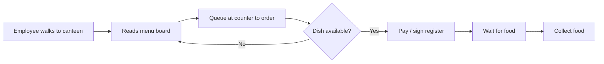
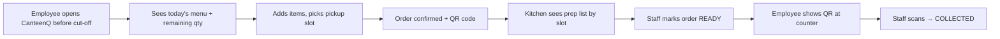

# Stage 1 — Discovery

**Product:** CanteenQ — Office Canteen Pre-order
**One-line brief:** *Let employees order lunch before they reach the canteen.*
**Author:** _<your name>_ · **Version:** 1.0 · **Date:** _<date>_

---

## 1. Problem statement

At lunchtime (roughly 12:30–14:00) most employees reach the canteen within the same 30–45 minutes. They queue once to order and pay, then wait again while the food is prepared. Popular dishes sell out early, and the kitchen still cooks too much of other dishes because it has no demand signal before service starts.

> **For** office employees who have a short lunch break, **who** lose 15–25 minutes queuing and often find their preferred dish sold out,
> **CanteenQ** is a web app that **lets them pre-order lunch from today's menu before a cut-off time and pick it up in a chosen time slot using a QR code**.
> **Unlike** the current walk-in, pay-at-counter process, **our product** gives the kitchen an accurate prep count before service and turns pickup into a 30-second scan.

### 1.1 Current process ("as-is")

**Pain points observed / expected**

| # | Pain point | Who feels it | Impact |
|---|---|---|---|
| P1 | Long queue at peak time | Employee | Lost break time, frustration |
| P2 | Popular dishes sell out; nobody knows until reaching the counter | Employee | Wasted trip, poor choice |
| P3 | No demand forecast; kitchen guesses quantities | Canteen manager | Food waste and stock-outs |
| P4 | Counter is crowded; staff take orders and hand them out at the same time | Canteen staff | Errors, stress, slow service |
| P5 | Manual register; hard to reconcile monthly employee bills | Manager / Admin | Billing disputes, effort |
| P6 | No data on what sells, when, or how much is wasted | Manager / Admin | No basis for improving the menu |

### 1.2 Target outcome ("to-be")

### 1.3 Success metrics (targets, to validate after launch)

| Metric | Baseline (assumed) | Target |
|---|---|---|
| Time from reaching the counter to receiving food | 15–25 min | **< 3 min** for pre-orders |
| Share of lunches that are pre-ordered (after 4 weeks) | 0% | **≥ 40%** |
| Prepared food left over at the end of service | Unknown, to be measured | **−20%** compared with week 1 |
| No-show rate (ordered but not collected) | n/a | **< 5%** |
| Orders placed without errors (no 4xx/5xx shown to user) | n/a | **≥ 99%** |

---

## 2. Personas

### Persona 1 — Priya Sharma, Software Engineer *(Role: Employee)*

| | |
|---|---|
| **Age / context** | 27, hybrid worker, in office 3 days a week, back-to-back meetings |
| **Tech comfort** | High; orders everything on her phone |
| **Goals** | Get a hot lunch within her 30-minute gap between meetings; avoid queuing; eat the dish she actually wants |
| **Pain points** | Queue at 13:00 takes 20 min; her favourite paneer dish is usually gone by 13:15; doesn't know the menu until she arrives |
| **Behaviours** | Checks the calendar in the morning; would order at 10:00 if she could; occasionally changes plans when a meeting overruns |
| **Quote** | *"I don't mind paying. I mind standing in line for 20 minutes to find out it's sold out."* |
| **What she needs from CanteenQ** | Mobile-first menu, fast checkout, pickup slot, the ability to cancel when plans change, a clear "your food is ready" signal |

### Persona 2 — Ramesh Iyer, Canteen Manager *(Role: Canteen Manager)*

| | |
|---|---|
| **Age / context** | 45, runs the canteen under contract for the company; 12 years in catering |
| **Tech comfort** | Medium; uses WhatsApp and Excel, uses a laptop in the canteen office |
| **Goals** | Cook the right quantity; reduce waste; keep employees happy so the contract is renewed; get monthly billing right |
| **Pain points** | Guesses quantities from experience; throws away food on Fridays; spends hours reconciling the paper register for billing |
| **Behaviours** | Plans the menu the day before; procures vegetables at 07:00; looks at numbers at the end of the day |
| **Quote** | *"If I knew at 11 o'clock how many people want biryani, I'd cook exactly that."* |
| **What he needs from CanteenQ** | Simple menu set-up, daily quantity limits, a prep list after cut-off, a dashboard of sales and no-shows, CSV export for billing |

### Persona 3 — Sunita Devi, Counter Staff *(Role: Canteen Staff)*

| | |
|---|---|
| **Age / context** | 34, serves at the counter during lunch; works on a shared tablet/phone |
| **Tech comfort** | Low to medium; comfortable with WhatsApp and scanning payment QR codes |
| **Goals** | Hand out the right order to the right person quickly; avoid arguments at the counter |
| **Pain points** | Handwritten tokens get lost; people jump the queue; confusion over who ordered what |
| **Behaviours** | Hands are busy, so she prefers big buttons and few taps; works in noisy, crowded conditions |
| **Quote** | *"Just show me something I can scan, and tell me what to give."* |
| **What she needs from CanteenQ** | An order queue grouped by slot, one-tap status changes, QR scan **or** type a 6-character code, a clear error for wrong-day or already-collected orders |

### Persona 4 — Anil Mehta, Facilities / Admin Manager *(Role: Admin)*

| | |
|---|---|
| **Age / context** | 40, owns the canteen vendor contract and the employee-amenities budget |
| **Tech comfort** | Medium to high |
| **Goals** | Make sure only employees use the system; set company rules (cut-off time, pickup window, holidays); hold the vendor accountable with data |
| **Pain points** | Complaints about the canteen reach him; has no data to back or challenge the vendor |
| **Behaviours** | Logs in weekly; wants reports, not daily operations |
| **Quote** | *"I need to see usage and complaints in numbers, not anecdotes."* |
| **What he needs from CanteenQ** | User and role management, settings (cut-off, slots, closed days), a read-only dashboard and exports |

---

## 3. Assumptions

Each assumption is stated openly and has a way to validate it. Any assumption that proves false is logged as a change in `02-requirements.md`.

| ID | Assumption | Type | Risk if wrong | How I'll validate |
|---|---|---|---|---|
| A1 | There is **one canteen** with **one vendor** at a single office location. | Scope | Medium: multi-vendor support changes the data model | Confirm with facilities/admin |
| A2 | The MVP covers **lunch only**; the same flow could later be reused for breakfast and snacks. | Scope | Low | Interviews |
| A3 | **No online payment.** Orders are recorded against the employee and settled at month-end (payroll deduction or vendor bill) or paid at the counter. | Business | High: payment gateway work would not fit one week | Confirm with admin; listed under **Won't** |
| A4 | Employees sign up with a **company email domain** (`@rubicotech.com` or `@rubicotech.in`); anyone else is rejected. | Security | Medium | Configurable allowed domain(s) in settings |
| A5 | The default **order cut-off is 11:00 IST** on the same day; pickup slots run **12:30–14:30 in 15-minute steps**. All are configurable by the Admin. | Business | Medium | Validate with the canteen manager |
| A6 | An employee has **at most one active lunch order per day** (more than one item is allowed in it). | Business | Low | Interviews; simple to relax later |
| A7 | Up to **5 units of one item** per order (stops bulk buying of popular items). | Business | Low | Configurable `maxQtyPerItem` |
| A8 | The menu is set **per day**, with a **daily quantity limit** for each dish that the manager controls. | Business | Medium | Manager interview |
| A9 | Staff use a **shared phone or tablet** with a camera at the counter and have Wi-Fi or 4G. | Technical | Medium: no camera means manual code entry | Manual 6-character code entry is always available as a fallback |
| A10 | Peak load is about **300 concurrent users** in the 10 minutes before cut-off (office of about 800 people). | Technical | Medium | Load test in Stage 7 (`07-non-functional-test.md`) |
| A11 | All business times use **Asia/Kolkata (IST)**. Timestamps are stored in UTC. | Technical | High: date bugs near midnight and cut-off | Unit tests around cut-off boundaries |
| A12 | Prices are in **INR** and stored as integer **paise** so floating-point rounding errors cannot occur. | Technical | Medium | Code review + unit tests |
| A13 | **Free-tier hosting** (Netlify for the web app, Render for the API, Neon Postgres) is enough for a demo and a pilot. | Cost | Medium: the free API host sleeps when idle | Warm-up before demos; monitor usage dashboards |
| A14 | If an order is not collected by **slot end + 30 min**, it is marked **NO_SHOW** and still billed (the policy is set by the Admin). | Business | Medium: policy may differ | Confirm with admin; feature is a **Should** |
| A15 | Users are on modern mobile or desktop browsers (latest 2 versions of Chrome, Safari, Edge and Firefox). | Technical | Low | Responsive UI tests on 3 viewports |

### 3.1 Notes on the challenge brief itself

- The brief says the MVP should "fit 2 weeks", but the challenge lasts **one week**. I sized the **Must** list to be buildable in about 4–5 days, with 1–2 days left for testing and the demo (see `06-build-plan.md`).
- "Common minimum requirements" says **8** minimums but lists **6**. All 6 are covered; see the compliance table in `README.md`.

---

## 4. Discovery interview guide (used with 3–5 colleagues)

1. Walk me through yesterday's lunch, from leaving your desk to finishing your meal.
2. How long did you wait? What happened while you waited?
3. When was the last time your preferred dish was sold out? What did you do?
4. How do you pay today? Any problems with the bill?
5. If you could order in the morning, **when** would you do it? What would make you cancel?
6. *(Canteen manager)* How do you decide how much to cook? What happens to leftovers?
7. *(Counter staff)* What causes most of the mistakes or arguments at the counter?
8. *(Admin)* Which rules must the system enforce? Who may use the canteen?

**Interview log** (fill in after real conversations; this is the evidence for the personas):

| # | Date | Role | Key insight | Persona / assumption affected |
|---|---|---|---|---|
| 1 | | | | |
| 2 | | | | |
| 3 | | | | |
