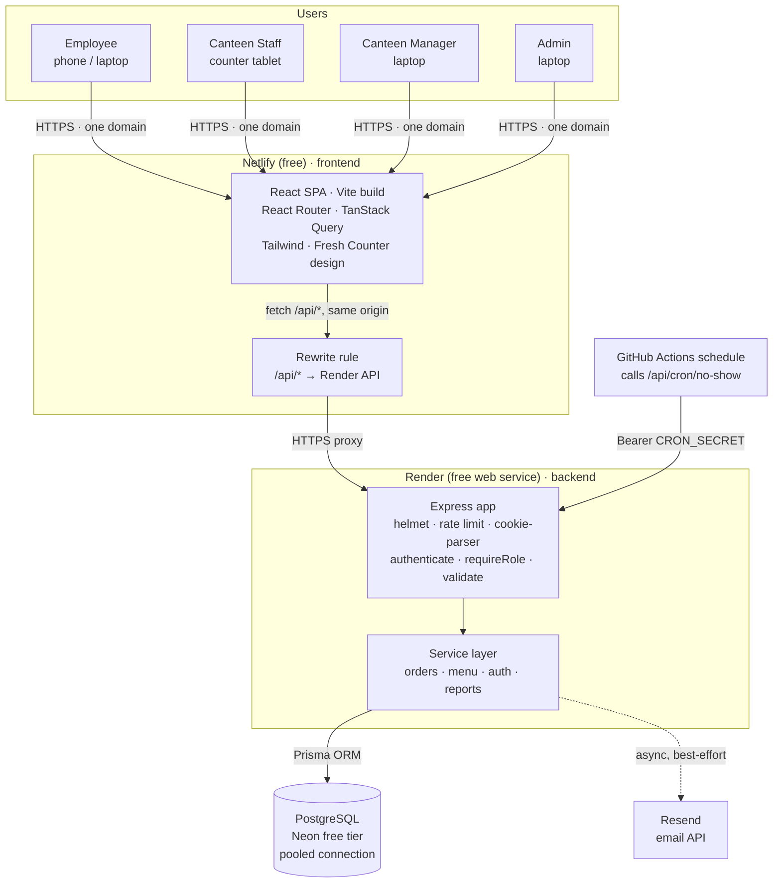
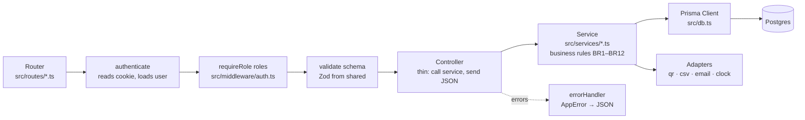
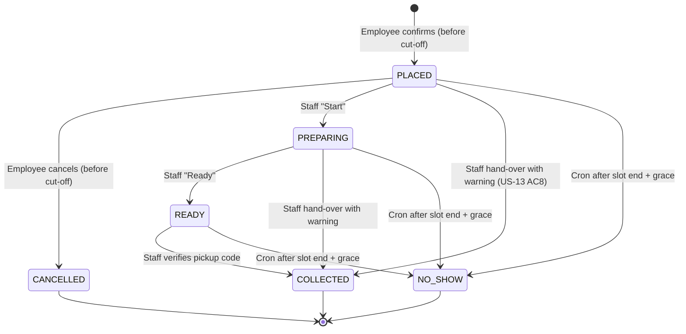
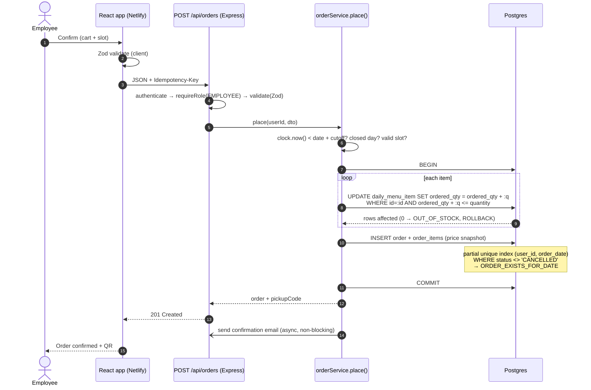
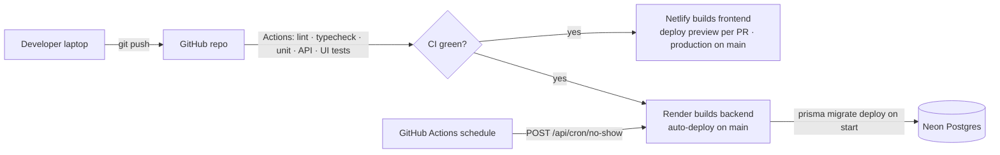

# Stage 5a — Architecture

Related: [ADR-001](04-adr-001-tech-stack.md) · [Data model](05-data-model.md) · [API list](05-api-spec.md) · [Wireframes](05-wireframes.md)

> **Rule:** this diagram must match the code. If you change a component, update this file in the same commit.

## 1. System context



**Why the proxy matters:** the browser only ever talks to the Netlify domain. Netlify forwards `/api/*` to the Render API, so the session cookie is a normal first-party cookie (`SameSite=Lax`) and no cross-site cookie or CORS setup is needed. Locally, Vite's `server.proxy` does the same job.

## 2. Layers inside the Express API



- **Middleware order** (in `app.ts`): `helmet` → `express.json` (bad JSON → `400 INVALID_JSON`) → `cookie-parser` → `testClock` (test only) → `rateLimit` (login) → routes → `notFound` → `errorHandler`.
- **`app.ts` vs `server.ts`:** `app.ts` builds and exports the Express app; `server.ts` only calls `app.listen()`. Supertest imports `app` directly, so API tests run in-process without a network port.
- **Controllers** stay thin: the middleware has already authenticated, checked the role and validated the body, so a controller just calls a service and sends the result.
- **Services** hold all business rules and are **unit-tested** with an injected `clock` (so cut-off times can be tested without waiting).
- **`clock.ts`** is the single source of "now" in IST. Unit tests inject a fake clock. API and UI tests send an `x-test-now` header, which the `testClock` middleware honours **only** when `ENABLE_TEST_CLOCK=true` (CI and local runs only). Production ignores it, and TC-API-SYS-02 proves that. This is how the cut-off edge cases are tested without waiting until 11:00.
- **Errors**: services throw a typed `AppError(code, httpStatus, message, fields?)`. A single `handleError()` converts it into the standard error JSON (see the API spec).

## 3. Role-based access matrix

| Capability | EMPLOYEE | STAFF | MANAGER | ADMIN |
|---|:-:|:-:|:-:|:-:|
| Sign up / log in / log out | ✅ | ✅ | ✅ | ✅ |
| View daily menu | ✅ | ✅ | ✅ | ✅ |
| Place / cancel **own** order | ✅ | ❌ | ❌ | ❌ |
| View own orders + QR | ✅ | ❌ | ❌ | ❌ |
| View **all** orders (queue) | ❌ | ✅ | ❌ | ❌ |
| Change order status / verify pickup | ❌ | ✅ | ❌ | ❌ |
| Prep list | ❌ | ✅ | ❌ | ❌ |

> **Change (2026-11-23):** the orders queue & prep section (queue, scan / verify, status changes, prep list, reading one order) is **STAFF only**. Managers work from the console (dashboard, menus, exports) and get 403 on these endpoints and "Not authorised" on `/staff/*`.
| Manage menu items and daily menu | ❌ | ❌ | ✅ | ❌ |
| Dashboard | ❌ | ❌ | ✅ | ✅ (read-only) |
| CSV export | ❌ | ❌ | ✅ | ✅ |
| Manage users / roles | ❌ | ❌ | ❌ | ✅ |
| Settings and closed dates | ❌ | ❌ | ❌ | ✅ |

> Design choice: STAFF, MANAGER and ADMIN cannot place orders in the MVP. Keeping operational accounts separate from consumer accounts keeps RBAC tests simple. *(If needed later, a staff member can also have a separate employee account.)*

Enforcement happens in **three places**: (1) `requireRole('MANAGER')` Express middleware on every API route, which is **the real security boundary**; (2) React Router `<RequireRole>` layout routes send users to `/login` or `/403`; (3) the UI hides navigation items for convenience only. Items 2 and 3 can be bypassed by anyone with dev tools, which is why RBAC is tested at the API level (TC-API-RBAC-*).

## 3a. Frontend structure (frontend)

| Route | Layout | Role | Screen |
|---|---|---|---|
| `/login`, `/signup` | Public | — | S1, S2 |
| `/menu`, `/menu/checkout`, `/orders`, `/orders/:id`, `/profile` | **EmployeeShell** (header + bottom nav, mobile-first) | EMPLOYEE | S3, S4, S6, S5 |
| `/staff/queue`, `/staff/scan`, `/staff/prep` | **StaffShell** (counter top bar) | STAFF | S7, S8, S9 |
| `/manager/dashboard`, `/manager/menu-items`, `/manager/daily-menu`, `/manager/exports` | **ConsoleShell** (left sidebar, as in the Stitch S10 design) | MANAGER (dashboard + exports also ADMIN) | S10, S11–S13, S16 |
| `/admin/users`, `/admin/settings` | ConsoleShell | ADMIN | S14, S15 |
| `/403`, `*` | Public | — | S17 |

Data is fetched with TanStack Query hooks (`useDailyMenu`, `useOrder`, `useQueue`…). Polling is used for live updates: order status every 20 s, staff queue every 15 s, dashboard every 30 s.

## 4. Order lifecycle (state machine, BR7)



Allowed transitions are defined once in `backend/src/services/orderStatus.ts` (a `Record<Status, Status[]>`) and fully unit-tested (TC-U-07).

## 5. Key flow — placing an order (concurrency-safe)



**Why a conditional `UPDATE` instead of "read, check, write":** reading the remaining quantity and then writing it creates a race condition. Two requests can both read "1 left" and both succeed. The single conditional `UPDATE` is atomic in Postgres, so the database itself enforces BR2. This is verified by TC-API-ORD-09 and the k6 test TC-NFR-02.

## 6. Deployment



| Environment | Web URL | API | DB |
|---|---|---|---|
| Local | `http://localhost:5173` (Vite, proxies `/api` → 4000) | `http://localhost:4000` | Docker Postgres or a Neon dev branch |
| CI | ephemeral | in-process (Supertest) and `node dist/server.js` for Playwright | Postgres service container in GitHub Actions |
| Staging (load test) | Netlify deploy preview | separate Render service with `ENABLE_TEST_CLOCK=true` | Neon **dev branch** |
| Production | `https://<project>.netlify.app` | `https://<api>.onrender.com` (reached via the `/api` proxy) | Neon main branch |

**Netlify config** (`frontend/netlify.toml`):
```toml
[build]
  base = "frontend"
  command = "npm run build"
  publish = "dist"

[[redirects]]
  from = "/api/*"
  to = "https://<api>.onrender.com/api/:splat"
  status = 200
  force = true

[[redirects]]          # SPA fallback for React Router
  from = "/*"
  to = "/index.html"
  status = 200
```

**Settings and secrets:** the API holds `DATABASE_URL`, `DIRECT_URL`, `SESSION_SECRET`, `RESEND_API_KEY`, `CRON_SECRET`, `WEB_ORIGIN` (in Render's environment settings). The web app only needs `VITE_API_BASE=/api` (no secrets in the frontend). GitHub holds `CRON_SECRET` and `API_URL` for the scheduled job. `.env` files are git-ignored; `.env.example` files are committed.

**Slow requests:** serverless cold starts can make the first request after a quiet period slower. When any request takes more than 1 second, the UI shows a loader (a thin progress bar across the top and a small spinner).

## 7. Repository structure

```
canteenQ/                             # npm workspaces monorepo: shared · backend · frontend
├── backend/                          # BACKEND: Express + Prisma (Render)
│   ├── src/
│   │   ├── app.ts                    # builds the Express app (imported by Supertest)
│   │   ├── server.ts                 # app.listen()
│   │   ├── routes/                   # auth, settings, menu, daily menu, slots, orders, staff, reports, cron
│   │   ├── middleware/               # authenticate, requireRole, validate, testClock, asyncHandler
│   │   ├── services/                 # orderService, dailyMenuService, rules, pickupCode, orderStatus, …
│   │   ├── adapters/                 # clock, qr, csv, email
│   │   └── db.ts
│   ├── prisma/                       # schema.prisma, migrations/, seed.ts
│   └── tests/
│       ├── unit/                     # Vitest (sprintNN.* = scripts gated per sprint)
│       ├── api/                      # Supertest + Vitest (sprintNN/ = gated per sprint)
│       ├── e2e/seed-e2e.ts           # E2E database reset + fixtures
│       └── perf/                     # k6 load test + oversell SQL checks
├── frontend/                         # FRONTEND: React + Vite + Tailwind (Netlify)
│   ├── src/
│   │   ├── routes/                   # page components per screen (S1–S17)
│   │   ├── layouts/                  # EmployeeShell, StaffShell, ConsoleShell, RequireRole
│   │   ├── components/ui/            # Fresh Counter components (Button, DietMarker, Ticket…)
│   │   ├── features/                 # cart/, ordering/, …
│   │   ├── api/                      # fetch client + TanStack Query hooks
│   │   └── styles/                   # Tailwind theme tokens from DESIGN.md
│   ├── tests/e2e/                    # Playwright UI (desktop + mobile; sprintNN/ = gated per sprint)
│   ├── playwright.config.ts          # starts the API (:4010) and vite preview (:4173)
│   ├── netlify.toml
│   └── vite.config.ts                # dev proxy /api → :4000
├── shared/                           # Zod schemas, types, constants, money helpers (used by backend + frontend)
├── scripts/                          # test-cases-index.py, trace-matrix.py
├── docs/                             # ← this folder (incl. docs/design/, docs/sprints/, docs/test-cases/)
└── .github/workflows/ci.yml
```

## 8. Security design summary

| Threat | Control |
|---|---|
| Password theft | bcrypt cost 12; passwords never logged or returned |
| Brute-force login | 5 attempts / 15 min per email (BR11) |
| Session theft / CSRF | httpOnly, Secure, SameSite=Lax cookie (first-party thanks to the `/api` proxy); 8 h expiry; state-changing requests use POST, PATCH, PUT or DELETE with JSON bodies only; CORS allows only `WEB_ORIGIN` |
| Common web attacks | `helmet` security headers on the API; Netlify `_headers` file sets CSP, `X-Frame-Options` and `Permissions-Policy` (camera only on `/staff/scan`) for the web app |
| Abuse / flooding | `express-rate-limit` on login and sign-up; general limit per IP on `/api` |
| Privilege escalation | Role re-read from the DB on every request; server-side guard on every handler; RBAC API tests |
| IDOR (reading other users' orders) | Queries are scoped by `userId` for EMPLOYEE; return 404 instead of 403 |
| Injection | Prisma parameterised queries; Zod validation; React output escaping; CSV formula escaping |
| Secrets leakage | Environment variables only; `.env` git-ignored |
| QR spoofing / guessing | 6 random characters from a 32-character alphabet without look-alike characters (32⁶ ≈ 1.07 billion combinations) via `crypto.randomInt`; valid only on the order date; single use |
