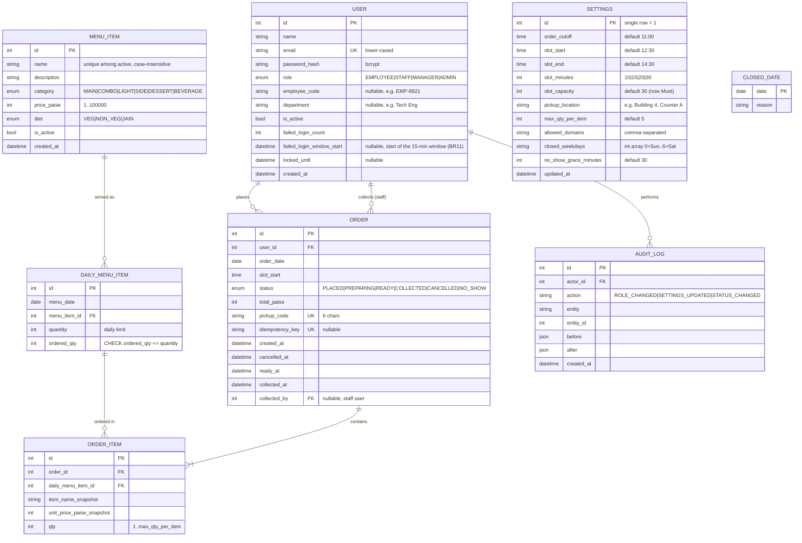

# Stage 5b — Data Model

## 1. ER diagram



## 2. Constraints and indexes (where the business rules are enforced)

| Table | Constraint / index | Enforces |
|---|---|---|
| `user` | `UNIQUE(email)` (stored lower-case) | US-01 AC3, AC5 |
| `menu_item` | Partial unique index `UNIQUE(lower(name)) WHERE is_active` | US-06 AC4 |
| `menu_item` | `CHECK (price_paise BETWEEN 100 AND 100000)` | US-06 AC2 |
| `daily_menu_item` | `UNIQUE(menu_date, menu_item_id)` | US-07 AC4 |
| `daily_menu_item` | `CHECK (ordered_qty >= 0 AND ordered_qty <= quantity)` | **BR2**: the last line of defence against overselling |
| `order` | `UNIQUE(pickup_code)` | BR8 |
| `order` | **Partial unique index** `UNIQUE(user_id, order_date) WHERE status <> 'CANCELLED'` (raw SQL migration) | **BR4** |
| `order` | `UNIQUE(idempotency_key)` | US-09 AC9 |
| `order` | `INDEX(order_date, slot_start, status)` | Staff queue and dashboard queries |
| `order_item` | `CHECK (qty >= 1)` | BR3 |

### Raw SQL migration (Prisma can't express partial indexes)

```sql
-- backend/prisma/migrations/xxxx_partial_indexes/migration.sql
CREATE UNIQUE INDEX "order_one_active_per_day"
  ON "Order" ("userId", "orderDate")
  WHERE "status" <> 'CANCELLED';

CREATE UNIQUE INDEX "menu_item_active_name"
  ON "MenuItem" (lower("name"))
  WHERE "isActive" = true;

ALTER TABLE "DailyMenuItem"
  ADD CONSTRAINT "ordered_within_quantity"
  CHECK ("orderedQty" >= 0 AND "orderedQty" <= "quantity");
```

## 3. Prisma schema (starting point)

```prisma
generator client { provider = "prisma-client-js" }

datasource db {
  provider  = "postgresql"
  url       = env("DATABASE_URL")   // pooled
  directUrl = env("DIRECT_URL")     // migrations
}

enum Role        { EMPLOYEE STAFF MANAGER ADMIN }
enum OrderStatus { PLACED PREPARING READY COLLECTED CANCELLED NO_SHOW }
enum Category    { MAIN COMBO LIGHT SIDE DESSERT BEVERAGE }
enum Diet        { VEG NON_VEG JAIN }

model User {
  id               Int       @id @default(autoincrement())
  name             String    @db.VarChar(80)
  email            String    @unique @db.VarChar(254)
  passwordHash     String
  role             Role      @default(EMPLOYEE)
  employeeCode     String?   @db.VarChar(20)
  department       String?   @db.VarChar(60)
  isActive         Boolean   @default(true)
  failedLoginCount Int       @default(0)
  failedLoginWindowStart DateTime? // start of the 15-min failed-login window (BR11)
  lockedUntil      DateTime?
  createdAt        DateTime  @default(now())
  orders           Order[]   @relation("OrderOwner")
  collected        Order[]   @relation("OrderCollector")
}

model Settings {
  id                  Int      @id @default(1)
  orderCutoff         String   @default("11:00") // HH:mm IST
  slotStart           String   @default("12:30")
  slotEnd             String   @default("14:30")
  slotMinutes         Int      @default(15)
  slotCapacity        Int      @default(30)
  pickupLocation      String   @default("Main canteen counter") @db.VarChar(80)
  maxQtyPerItem       Int      @default(5)
  allowedDomains      String   @default("rubicotech.com,rubicotech.in")
  closedWeekdays      Int[]    @default([0, 6])
  noShowGraceMinutes  Int      @default(30)
  updatedAt           DateTime @updatedAt
}

model ClosedDate {
  date   DateTime @id @db.Date
  reason String   @db.VarChar(120)
}

model MenuItem {
  id          Int             @id @default(autoincrement())
  name        String          @db.VarChar(80)
  description String?         @db.VarChar(300)
  category    Category
  pricePaise  Int
  diet        Diet
  isActive    Boolean         @default(true)
  createdAt   DateTime        @default(now())
  dailyItems  DailyMenuItem[]
}

model DailyMenuItem {
  id         Int         @id @default(autoincrement())
  menuDate   DateTime    @db.Date
  menuItemId Int
  quantity   Int
  orderedQty Int         @default(0)
  menuItem   MenuItem    @relation(fields: [menuItemId], references: [id])
  orderItems OrderItem[]
  @@unique([menuDate, menuItemId])
}

model Order {
  id             Int         @id @default(autoincrement())
  userId         Int
  orderDate      DateTime    @db.Date
  slotStart      String      // "13:00"
  status         OrderStatus @default(PLACED)
  totalPaise     Int
  pickupCode     String      @unique @db.Char(6)
  idempotencyKey String?     @unique
  createdAt      DateTime    @default(now())
  cancelledAt    DateTime?
  readyAt        DateTime?
  collectedAt    DateTime?
  collectedById  Int?
  user           User        @relation("OrderOwner", fields: [userId], references: [id])
  collectedBy    User?       @relation("OrderCollector", fields: [collectedById], references: [id])
  items          OrderItem[]
  @@index([orderDate, slotStart, status])
}

model OrderItem {
  id                     Int           @id @default(autoincrement())
  orderId                Int
  dailyMenuItemId        Int
  itemNameSnapshot       String
  unitPricePaiseSnapshot Int
  qty                    Int
  order                  Order         @relation(fields: [orderId], references: [id], onDelete: Cascade)
  dailyMenuItem          DailyMenuItem @relation(fields: [dailyMenuItemId], references: [id])
}

model AuditLog {
  id        Int      @id @default(autoincrement())
  actorId   Int
  action    String
  entity    String
  entityId  Int
  before    Json?
  after     Json?
  createdAt DateTime @default(now())
}
```

## 4. Data design decisions

| Decision | Reason |
|---|---|
| Money stored as **integer paise** | Avoids floating-point errors (₹0.1 + ₹0.2 ≠ ₹0.3) (A12) |
| Name and price **copied onto `OrderItem`** | Old orders don't change when the menu changes (BR6) |
| `ordered_qty` counter on `DailyMenuItem` | Atomic conditional update for stock; O(1) "remaining" = `quantity - ordered_qty` |
| Dates stored as `DATE` in IST; timestamps in UTC | Avoids midnight and cut-off bugs (A11) |
| Pickup code separate from the internal ID | IDs are not exposed in the QR code; codes are not sequential |
| Soft archive for menu items (`is_active`) | Keeps order history intact |
| `employee_code`, `department` optional on User | Shown on checkout, the live orders feed and the monthly statement (design decisions D5, D17); not required to sign up |
| `pickup_location` as one setting | The design shows a counter/location on several screens (D1); one canteen only (A1), so one text field is enough |
| `COMBO` and `LIGHT` categories | Used as labels on the dish tiles in the design (D2) |

## 5. Seed data (`backend/prisma/seed.ts`)

| Email | Password | Role |
|---|---|---|
| `admin@rubicotech.com` | `Admin@2026` | ADMIN |
| `manager@rubicotech.com` | `Manager@2026` | MANAGER |
| `staff@rubicotech.com` | `Staff@2026` | STAFF |
| `priya@rubicotech.com` | `Employee@2026` | EMPLOYEE |

Plus the 6 dishes used in the Stitch design (Veg Biryani ₹120 · MAIN, Chicken Curry ₹150 · MAIN, Paneer Butter Masala ₹130 · MAIN, Dal Tadka + Rice ₹80 · COMBO, Curd Rice ₹60 · LIGHT, Masala Chaas ₹25 · BEVERAGE), today's and tomorrow's daily menu, and settings with `pickupLocation` "Building 4 · Counter A". Demo users have an `employeeCode` and `department` (e.g. Priya: EMP-8921, Tech Eng). *(Demo and test credentials only. Change them in production.)*
