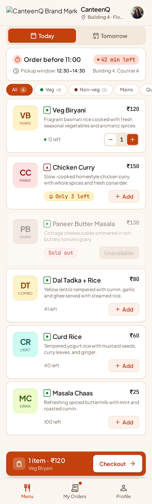
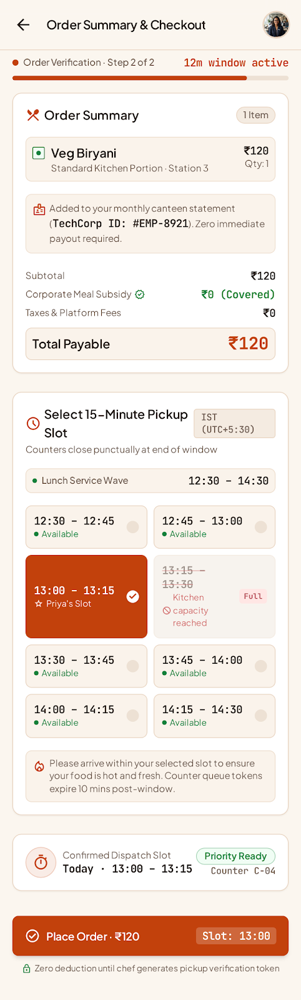
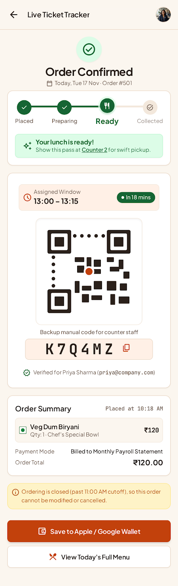
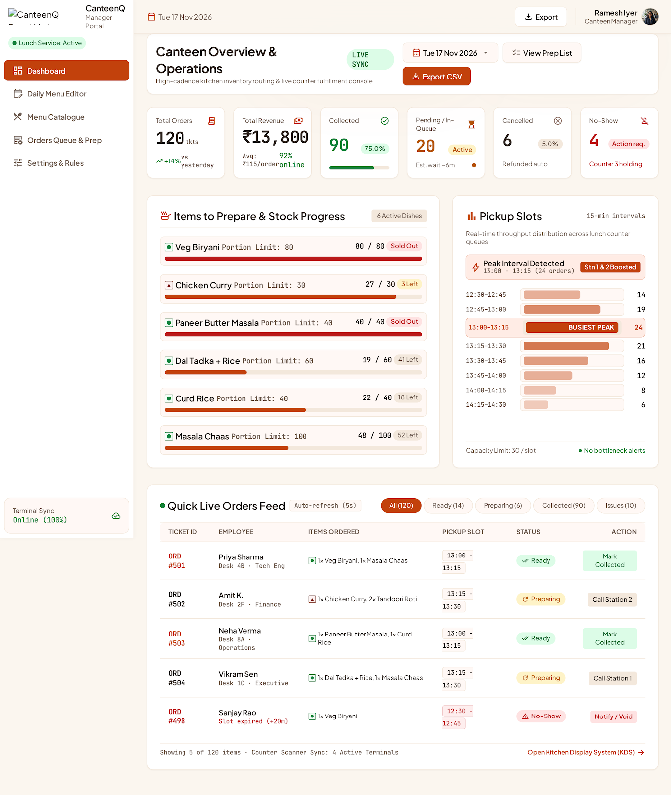

# Stage 5d — Key Screen Wireframes (low fidelity)

> **Update (v2):** these low-fidelity wireframes were the starting point. The **high-fidelity design we build from** is the Stitch export in [`docs/design/`](design/): the **"Fresh Counter"** design system (`design/fresh_counter/DESIGN.md`) and four finished screens: S3 Today's menu, S4 Checkout + slot selection, S5 Order pass / QR ticket, S10 Manager dashboard. Screens not in the export are built with the same components. Where the Stitch design adds details beyond the requirements, the decisions are recorded in `02-requirements.md §6` (D1–D21) and the design brief is in [`05-ui-design-requirements.md`](05-ui-design-requirements.md).

These are five key screens, drawn mobile-first for employee and staff screens and desktop for the manager. Annotations `[n]` link the screens to stories. *(You can redraw these in Excalidraw or Figma and export PNGs to `docs/img/` if the judges prefer images. Keep this file as the annotated source.)*

---

## W1 · Today's Menu + Cart (Employee, 360 px): US-08, US-09

```
┌──────────────────────────────────┐
│ ☰  CanteenQ            Priya ▾  │
├──────────────────────────────────┤
│ [ Today 17 Nov ] [ Tomorrow ]    │  [1] tabs: today / tomorrow only
│ ⏱ Order before 11:00 · 42 min left│  [2] countdown to cut-off (server time)
│ Filter: (All)(Veg)(Non-veg)      │  (S07)
├──────────────────────────────────┤
│ 🟢 Veg Biryani          ₹120.00  │
│ Fragrant basmati, raita          │
│ 12 left            [ − 1 + ]     │  [3] stepper 1..5, disabled at max
├──────────────────────────────────┤
│ 🔴 Chicken Curry        ₹150.00  │
│ 3 left                [ Add ]    │
├──────────────────────────────────┤
│ 🟢 Paneer Butter Masala ₹130.00  │
│ SOLD OUT             [ Add ]░░   │  [4] disabled when remaining = 0
├──────────────────────────────────┤
│                                  │
├──────────────────────────────────┤
│ 🛒 1 item · ₹120.00  [ Checkout ▸]│  [5] sticky cart bar (≥ 44 px)
├──────────────────────────────────┤
│  🍽 Menu   📋 My Orders   👤 Me  │  bottom nav (mobile)
└──────────────────────────────────┘
After cut-off: banner "Ordering for today closed at 11:00 → order for tomorrow"
```

## W2 · Checkout: pick a slot (Employee, 360 px): US-09, US-19

```
┌──────────────────────────────────┐
│ ←  Checkout                      │
├──────────────────────────────────┤
│ Pickup on Tue 17 Nov             │
│                                  │
│ Veg Biryani      × 1    ₹120.00  │
│ ─────────────────────────────── │
│ Total                   ₹120.00  │
│ Billed to your monthly statement │  [1] assumption A3: no online pay
├──────────────────────────────────┤
│ Choose pickup slot               │
│ (12:30) (12:45) (13:00✓) (13:15) │  [2] chips; FULL slots greyed (S03)
│ (13:30) (13:45) (14:00) (14:15)  │
│ 13:30 FULL ░░                    │
├──────────────────────────────────┤
│ ⚠ Only 1 Veg Biryani left        │  [3] inline 409 error area
├──────────────────────────────────┤
│      [  Confirm order  ]         │  [4] disabled while submitting
│                                  │      (prevents double tap + Idempotency-Key)
└──────────────────────────────────┘
```

## W3 · Order confirmed / My Orders with QR (Employee, 360 px): US-10, US-11

```
┌──────────────────────────────────┐
│ ←  My Orders                     │
├──────────────────────────────────┤
│ TODAY · Pickup 13:00–13:15       │
│ Status: ● PLACED  → PREPARING →  │  [1] status stepper; auto-refresh 30 s
│          READY → COLLECTED       │
│                                  │
│        ┌──────────────┐          │
│        │ ▓▓ ▓ ▓▓▓ ▓▓ │          │  [2] QR (code only, no PII)
│        │ ▓ ▓▓  ▓ ▓ ▓ │          │
│        │ ▓▓▓ ▓ ▓▓ ▓▓ │          │
│        └──────────────┘          │
│          K 7 Q 4 M Z             │  [3] large code for manual entry
│                                  │
│ Veg Biryani × 1        ₹120.00   │
│ [ Cancel order ]                 │  [4] visible only before cut-off
├──────────────────────────────────┤
│ HISTORY                          │
│ 16 Nov · Dal Tadka ×1 · ₹80 ✔    │  COLLECTED
│ 14 Nov · Veg Biryani ×1 · ₹120 ✖ │  CANCELLED
│ 13 Nov · Curd Rice ×1 · ₹60 ⚠    │  NO_SHOW
│           [ Load more ]          │
└──────────────────────────────────┘
```

## W4 · Staff counter: queue + scan (Staff, 768 px tablet): US-12, US-13

```
┌──────────────────────────────────────────────────────────────┐
│ CanteenQ · Counter                    [ 📷 Scan / Enter code ]│ [1]
├──────────────────────────────────────────────────────────────┤
│ Today 17 Nov  Filter: (All)(Placed 40)(Preparing 8)(Ready 12) │
├──────────────────────────────┬───────────────────────────────┤
│ 12:30–12:45  (14)            │ 12:45–13:00  (18)             │
│ ┌──────────────────────────┐ │ ┌───────────────────────────┐ │
│ │ K7Q4MZ  Priya S.         │ │ │ P9R2TX  Arjun K.          │ │
│ │ Veg Biryani ×1           │ │ │ Dal Tadka ×2              │ │
│ │ ● PLACED      [ Start ]  │ │ │ ● PREPARING   [ Ready ]   │ │ [2] one-tap
│ └──────────────────────────┘ │ └───────────────────────────┘ │
│ ┌──────────────────────────┐ │                               │
│ │ M3D8QA  Neha R. (strike) │ │                               │
│ │ ● CANCELLED  (greyed)    │ │                               │
│ └──────────────────────────┘ │                               │
├──────────────────────────────┴───────────────────────────────┤
│ [ Prep list ▸ ]  Veg Biryani 68 · Dal Tadka 41 · Curd Rice 22 │ [3]
└──────────────────────────────────────────────────────────────┘

Scan result sheet (modal):
┌────────────────────────────────────┐
│ ✅ K7Q4MZ · Priya Sharma           │
│ Veg Biryani × 1 · Slot 13:00       │
│ ⚠ Not marked ready yet  (US-13 AC8)│
│        [  HAND OVER  ]             │  [4] big green button
├────────────────────────────────────┤
│ Error variants (red):              │
│ ✖ Already collected at 13:04       │
│ ✖ This order is for 18 Nov         │
│ ✖ Order was cancelled              │
│ ✖ Code not found                   │
└────────────────────────────────────┘
```

## W5 · Manager dashboard (Manager / Admin, 1280 px): US-14, US-17

```
┌──────────────────────────────────────────────────────────────────────────────┐
│ CanteenQ   Dashboard | Menu | Daily menu | Queue | Exports      Ramesh ▾     │
├──────────────────────────────────────────────────────────────────────────────┤
│ Date: [ 17 Nov 2026 ▾ ]                              [ ⬇ Export CSV ]        │ [1]
├────────────┬────────────┬────────────┬────────────┬────────────┬─────────────┤
│ Orders     │ Revenue    │ Collected  │ Pending    │ Cancelled  │ No-show     │ [2] KPI tiles
│   120      │ ₹13,800    │    90      │    20      │     6      │     4       │
├────────────┴────────────┴──────┬─────┴────────────┴────────────┴─────────────┤
│ Items to prepare               │ Orders by pickup slot                       │
│ Dish          Ordered / Limit  │  20┤      ██                                 │ [3]
│ Veg Biryani      68 / 80 ▓▓▓▓░ │  15┤   ██ ██ ██                              │
│ Dal Tadka        41 / 60 ▓▓▓░░ │  10┤██ ██ ██ ██ ██                           │
│ Curd Rice        22 / 40 ▓▓░░░ │   5┤██ ██ ██ ██ ██ ██ ██                     │
│ Chicken Curry    30 / 30 ▓▓▓▓▓ │    └12:30 ──────────── 14:15                │
│        (SOLD OUT)              │                                             │
└────────────────────────────────┴─────────────────────────────────────────────┘
Empty state: tiles show 0 and charts show "No data for this date" (US-14 AC6)
```

---

### Screen-to-story map

| Wireframe | Screen route | Stories |
|---|---|---|
| W1 | `/menu` | US-08, US-09, US-16 |
| W2 | `/menu/checkout` | US-09, US-19 |
| W3 | `/orders` | US-10, US-11 |
| W4 | `/staff/queue`, `/staff/scan` | US-12, US-13 |
| W5 | `/manager/dashboard` | US-14, US-17 |

Other screens (not drawn): Login/Sign-up (US-01/02), Admin Users (US-04), Admin Settings (US-05), Menu Items (US-06), Daily Menu editor (US-07).

---

## High-fidelity design (Stitch "Fresh Counter")

These are the finished screens we build from. Source HTML and the design system are in `docs/design/`.

| S3 · Today's menu | S4 · Checkout + slot | S5 · Order pass / QR |
|---|---|---|
|  |  |  |

**S10 · Manager dashboard**



> Some details in these screens are intentionally **not** built as shown (e.g. the wallet button, subsidy rows, stations). See decisions D1–D21 in `02-requirements.md §6.1`.
