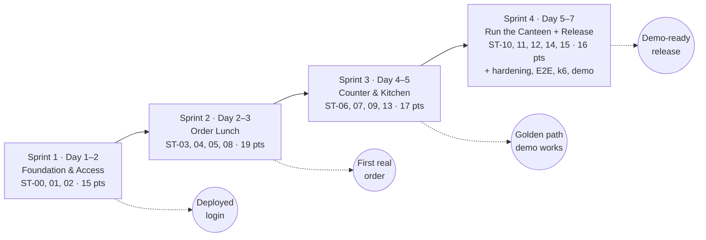

# Stage 6e — Sprint Plan: CanteenQ in 4 Sprints

**Based on:** `03-user-stories-v2.md` (19 vertical-slice stories, 76 points) · **Build prompts:** `06-claude-code-prompts.md` (C01–C46) · **Task IDs:** `06-build-tasks.md`
**Team:** 1 developer + AI assistants · **Challenge length:** 7 days → **4 mini-sprints of about 1.5–2 days**

---

## 1. Overview

| Sprint | Days | Sprint goal (what works at the end) | Stories | Points |
|---|---|---|---|---|
| **Sprint 1 · Foundation & Access** | Day 1 – Day 2 (midday) | The app is **deployed**: every role can log in and land on its own home, and the manager can **publish today's menu**. | ST-00, ST-01, ST-02 | 15 |
| **Sprint 2 · Order Lunch** | Day 2 (afternoon) – Day 3 | An employee can **browse the menu, order before 11:00 with a pickup slot, get a QR pass and cancel**. Stock never oversells. | ST-03, ST-04, ST-05, ST-08 | 19 |
| **Sprint 3 · Counter & Kitchen** | Day 4 – Day 5 (midday) | The **full lunch loop** works: staff prepare, scan and hand over; the kitchen has a prep list; the manager sees the **dashboard**. | ST-06, ST-07, ST-09, ST-13 | 17 |
| **Sprint 4 · Run the Canteen & Release** | Day 5 (afternoon) – Day 7 | Admins and managers run the canteen **without touching the database**; history and exports; **hardened, fully tested, demo-ready**. | ST-10, ST-11, ST-12, ST-14, ST-15 (+ stretch ST-16, ST-17, ST-18) | 16 (+9 stretch) |
| | | | **Total** | **67 committed + 9 stretch = 76** |

**Why this order**
- **Sprint 1** removes the integration risks first (deployment, the cookie proxy, the database constraints), and gives every later story a login and a menu to build on.
- **Sprint 2** takes on the **highest-risk story (ST-04: concurrency, time zone, double submit)** while there's still time to fix it.
- **Sprint 3** closes the loop at the counter. After Sprint 3, the **golden path demo** works end to end.
- **Sprint 4** adds the admin and management screens (lower risk, mostly forms and tables) plus the hardening needed for the judges.

---

## 2. Sprint 1 · Foundation & Access

**Goal:** *"Deployed walking skeleton: anyone with a company email can sign up; each role logs in to its own home; the manager can publish a daily menu."*
**Days:** Day 1 → Day 2 midday · **Points:** 15 · **Stories:** ST-00 (5), ST-01 (5), ST-02 (5)

### Feature list

| # | Feature | Story | Frontend | Backend | Tests |
|---|---|---|---|---|---|
| 1.1 | Monorepo + shared package (constants, money helpers, Zod schemas) | ST-00 | — | `shared` | TC-U-09, 11, 12, 15 |
| 1.2 | API skeleton: env validation, error format, logging, health check | ST-00 | — | `app.ts`, `errorHandler`, `/api/health` | TC-API-SYS-01, VAL-02 |
| 1.3 | Database: Prisma schema, constraint migration, seed (4 users, 6 dishes) | ST-00 | — | Prisma + raw SQL | DB constraint checks |
| 1.4 | Web skeleton with the Fresh Counter theme (tokens, fonts, icons, router) | ST-00 | Vite + Tailwind theme | — | Smoke E2E |
| 1.5 | CI pipeline (lint, typecheck, unit, API, E2E) | ST-00 | ✓ | ✓ | CI green |
| 1.6 | **Deployment:** API on Render, web on Netlify with the `/api` proxy | ST-00 | `netlify.toml` | Render service | Cookie check via proxy |
| 1.7 | IST clock + test clock + prod guard | ST-00 | — | `clock.ts`, `testClock` | TC-U-04, TC-API-SYS-02 |
| 1.8 | UI kit (buttons, inputs, diet marker, badges, cards, tickets, dialogs, toasts…) + `/dev/ui` gallery | ST-01 | `components/ui` | — | Visual check |
| 1.9 | Sign up with company email | ST-01 | S2 (mobile + desktop) | A1 | TC-API-AUTH-01..03, 08, TC-UI-01 |
| 1.10 | Log in / log out / session expiry / lockout | ST-01 | S1 (mobile + desktop) | A2–A4, lockout | TC-U-08, 14, TC-API-AUTH-04..07, 09 |
| 1.11 | Role guards + role-based layouts (employee, staff, console) | ST-01 | `RequireRole`, 3 shells, `/403` | `authenticate`, `requireRole` | TC-API-RBAC-02, 06, TC-UI-02, 03 |
| 1.12 | **Publish daily menu** with portion limits | ST-02 | S13 Daily menu editor | M1 (read), M4, M5 | TC-API-MENU-05..07, RBAC-05 |

**Claude Code prompts:** C01 → C07, C08 (clock part), C09, C10, C19, C20, C21, C22, C12 (daily-menu part), C34, C44 (first deploy)

### Exit criteria (Sprint review demo)
- [ ] Open the **Netlify URL** → sign up as a new employee → land on the (empty) menu
- [ ] Log in as staff, manager and admin → each lands on its own home; an employee opening `/manager/dashboard` sees 403
- [ ] As manager, publish tomorrow's menu; a quantity below "already ordered" shows the error
- [ ] CI green; API test count reported; prompt journal has entries for C01–C22

### Risks to watch
| Risk | Mitigation |
|---|---|
| Cookie not stored through the proxy | Verify on day 1 (SET-14) before building more screens |
| Too much time on the UI kit | Build only the components Sprint 1–2 screens need; the rest goes to Sprint 3 |

---

## 3. Sprint 2 · Order Lunch

**Goal:** *"Priya can browse today's menu, order before 11:00 with a pickup slot, get her QR pass and cancel if plans change, and two people can never buy the same last portion."*
**Days:** Day 2 afternoon → end of Day 3 · **Points:** 19 · **Stories:** ST-03 (5), ST-04 (8), ST-05 (3), ST-08 (3)

### Feature list

| # | Feature | Story | Frontend | Backend | Tests |
|---|---|---|---|---|---|
| 2.1 | Ordering rules: cut-off, today/tomorrow window, slots, closed days | ST-03/04 | — | `rules.ts` | TC-U-01..06 |
| 2.2 | **Today's menu** with stock, scarcity, sold out, filters with counts | ST-03 | S3 mobile + desktop | M4 (+ pickupLocation) | TC-UI-07 |
| 2.3 | Cut-off countdown and "ordering closed" state | ST-03 | Countdown from server time | — | TC-UI-08 |
| 2.4 | Empty / closed / not published states | ST-03 | S3 edge states | 422 / closed flag | TC-API-MENU-08 |
| 2.5 | Cart: mobile tray, desktop "Your order" panel, max per dish | ST-04 | Cart context | — | Cart unit tests |
| 2.6 | Pickup slots with remaining capacity and "Full" | ST-04 | S4 slot grid | M6 + capacity | TC-API-ORD-16 |
| 2.7 | **Place order**: atomic stock, slot capacity, price snapshot, one per day, idempotency | ST-04 | S4 checkout + error handling | O1, `orderService.place` | **TC-API-ORD-01..09, 15** |
| 2.8 | **Pickup pass**: QR, code, status stepper, live status | ST-05 | S5 mobile + desktop | O3, O4 | TC-API-ORD-14, RBAC-04 |
| 2.9 | Cancel before cut-off (stock restored, re-order allowed) | ST-08 | Cancel dialog on S5 | O5 | TC-API-ORD-10..12, TC-UI-09 |

**Claude Code prompts:** C08 (rules part), C12 (menu read + slots), C13, C14, C23, C24, C25, C26

### Exit criteria (Sprint review demo)
- [ ] On a **phone**: menu → add Veg Biryani → choose 13:00 → place order → QR pass with code
- [ ] TC-API-ORD-09 (10 parallel orders for the last portion) passes **5 runs in a row**
- [ ] With the test clock at 11:00:05, ordering and cancelling are refused
- [ ] Cancel → stock goes back up → re-order works
- [ ] Desktop layouts of S3, S4 and S5 match the canvas

### Risks to watch
| Risk | Mitigation |
|---|---|
| ST-04 takes longer than planned | It's the core of the product: move ST-08 (cancel) to Sprint 3 rather than cutting corners on ST-04 |
| AI writes a read-then-write stock check | Review C13 line by line; the concurrency test must fail if the conditional UPDATE is removed |

---

## 4. Sprint 3 · Counter & Kitchen

**Goal:** *"The full lunch loop works end to end: staff prepare orders by slot, scan the QR and hand over once; the kitchen has a prep list; the manager sees today's numbers."*
**Days:** Day 4 → Day 5 midday · **Points:** 17 · **Stories:** ST-06 (5), ST-07 (5), ST-09 (5), ST-13 (2)

### Feature list

| # | Feature | Story | Frontend | Backend | Tests |
|---|---|---|---|---|---|
| 3.1 | Order status machine (allowed transitions only) | ST-06 | — | `orderStatus.ts` | TC-U-07 |
| 3.2 | **Staff queue** grouped by slot, "Now serving", Start / Mark ready | ST-06 | S7 (tablet) | Q1, Q2 | TC-API-STF-01..03, TC-UI-15 |
| 3.3 | **Scan & hand over** (camera + typed code, single use, error states) | ST-07 | S8 (phone) | Q3, Q4 | TC-API-STF-05..10, TC-UI-10, TC-M-01 |
| 3.4 | Prep list with large numbers + print | ST-13 | S9 (tablet) | R2 | TC-API-STF-04 |
| 3.5 | **Manager dashboard**: 6 KPIs (vs yesterday, avg, collected %), items to prepare, slot chart | ST-09 | S10 | R1 (extended) | TC-API-RPT-01, 02, 05, TC-UI-13 |
| 3.6 | Demo seed matching the mockups (120 orders, K7Q4MZ) | ST-09 | — | `seed-demo.ts` | Visual compare |
| 3.7 | **Golden path E2E** (employee → staff → collected → dashboard) | all | — | — | **TC-UI-06** |

**Claude Code prompts:** C15, C16 (dashboard part), C28, C29, C30, C31, C39, C41 (golden path)

### Exit criteria (Sprint review demo)
- [ ] **Golden path live**: Priya orders on her phone → Sunita starts and marks ready on the tablet → scans K7Q4MZ → hand over → Priya's pass shows Collected → Ramesh's dashboard updates
- [ ] Scanning the same code again shows "Already collected at …"
- [ ] TC-UI-06 green in CI on desktop and mobile projects
- [ ] Dashboard with the demo seed looks like the S10 mockup

### Risks to watch
| Risk | Mitigation |
|---|---|
| Camera scanning is unreliable on some phones | Typed code is a first-class path (US-13 AC3); test on a real phone early (TC-M-01) |
| Dashboard queries are slow | One aggregated query per section; index on `(orderDate, slotStart, status)` |

---

## 5. Sprint 4 · Run the Canteen & Release

**Goal:** *"Managers and admins run the canteen from the UI (menu catalogue, users, rules, exports); employees see their history; the app is hardened, fully tested, load-tested and demo-ready."*
**Days:** Day 5 afternoon → Day 7 · **Points:** 16 committed + 9 stretch

### Feature list (committed)

| # | Feature | Story | Frontend | Backend | Tests |
|---|---|---|---|---|---|
| 4.1 | Menu catalogue: add / edit / archive dishes, price rules, duplicate names | ST-10 | S11 + S12 dialog | M1–M3 | TC-API-MENU-01..04, 09, TC-UI-05 |
| 4.2 | Users & roles: search, change role, disable, last-admin protection | ST-11 | S14 | U1, U2 | TC-API-USR-01..05, TC-UI-04 |
| 4.3 | Canteen rules: cut-off, pickup window, slot size and capacity, location, closed days, holidays | ST-12 | S15 | S1–S5 | TC-API-SET-01..04, ORD-15 |
| 4.4 | My orders: active order, history, monthly total | ST-14 | S6 mobile + desktop | O2 | TC-API-ORD-13 |
| 4.5 | CSV exports: orders by range, monthly statement, formula-injection safe | ST-15 | S16 | R3, R4 | TC-U-13, TC-API-RPT-03, 04, TC-UI-14 |
| 4.6 | Error pages (403, 404, unexpected) | DoD | S17 | — | TC-UI-03 |

### Stretch (only if committed work is done by Day 6 midday)

| # | Feature | Story | Points |
|---|---|---|---|
| 4.7 | Email: order confirmed + ready (never blocks ordering) | ST-16 | 3 |
| 4.8 | Auto no-show via GitHub Actions schedule | ST-17 | 3 |
| 4.9 | Dashboard live orders feed with code-verified collection | ST-18 | 3 |

### Hardening & release (Day 6 – Day 7, not stories)

| # | Item | Prompt | Evidence for judges |
|---|---|---|---|
| H1 | Security hardening (CORS, rate limits, helmet, graceful shutdown) + **RBAC matrix test** | C18 | TC-API-RBAC-01 |
| H2 | Responsive + accessibility pass, test IDs | C40 | Screens at 360 / 1280 px |
| H3 | Remaining E2E tests + **visual comparison with the design** | C42 | TC-UI-01..16, screenshots |
| H4 | Test gap sweep against the traceability matrix | C43 | Matrix with ✅ statuses |
| H5 | **k6 load test** (100 users, oversell SQL checks) on staging | C45 | `07-non-functional-test.md` results |
| H6 | README, final docs, bug log, retrospective, demo rehearsal | C46 | Demo script timed |

**Claude Code prompts:** C11, C33, C36, C37, C27, C16 (CSV part), C35, C38, then C18, C40, C42, C43, C45, C46; stretch C17, C32

### Exit criteria (final review = the 10-minute demo)
- [ ] Manager adds a dish, puts it on tomorrow's menu, exports last month's statement
- [ ] Admin promotes a user to Staff and changes the cut-off; the menu shows the new time
- [ ] All P1 test cases pass; no open Critical or High bugs
- [ ] k6: `place_order` p95 < 800 ms and **0 oversold items**
- [ ] Traceability matrix, bug log, prompt journal (≥ 3 AI mistakes) and retrospective complete

---

## 6. Feature list by sprint (one-page view)

| Sprint 1 · Foundation & Access | Sprint 2 · Order Lunch | Sprint 3 · Counter & Kitchen | Sprint 4 · Run the Canteen |
|---|---|---|---|
| Monorepo + shared schemas | Ordering rules (cut-off, slots) | Order status machine | Menu catalogue (S11, S12) |
| API skeleton + errors + health | Today's menu (S3) | Staff queue (S7) | Users & roles (S14) |
| Database + constraints + seed | Countdown + closed states | Scan & hand over (S8) | Canteen rules + holidays (S15) |
| Fresh Counter theme + UI kit | Cart (tray + desktop panel) | Prep list (S9) | My orders (S6) |
| CI pipeline | Pickup slots + capacity | Manager dashboard (S10) | CSV exports (S16) |
| Deploy: Netlify + Render + proxy | **Place order (atomic stock)** | Demo seed | Error pages (S17) |
| IST clock + test clock | Pickup pass + QR (S5) | **Golden path E2E** | *Stretch:* email, auto no-show, live feed |
| Sign up (S2) | Cancel + re-order | | Hardening, RBAC matrix, a11y |
| Login / logout / lockout (S1) | | | E2E + visual check, k6 load test |
| Role guards + 3 layouts + 403 | | | README, docs, demo rehearsal |
| Daily menu editor (S13) | | | |

---

## 7. How to run each sprint (solo, lightweight)

| Ceremony | When | 10-minute version | Evidence to keep |
|---|---|---|---|
| **Sprint planning** | Start of each sprint | Re-read the sprint goal and stories; confirm the prompts to use; adjust scope if the previous sprint overran | One line per sprint in this file (§8) |
| **Daily check** | Each morning | What's done, what's next, what's blocking (use the standup format) | Short note in the journal |
| **Sprint review** | End of each sprint | Run the exit-criteria demo on the **deployed** app; tick the boxes | Screenshot or short screen recording |
| **Sprint retro** | Right after the review | One thing that went well, one to change, one AI lesson | Feeds `08-retrospective.md` |

### Rules
- **Done means done:** a story counts only when it meets the Definition of Done in `03-user-stories-v2.md §3`.
- **Carry-over:** unfinished stories move to the next sprint *first*; drop stretch items before committed ones.
- **Never trade away:** ST-04 quality, the RBAC tests, the golden path E2E.
- **Drop order if late:** ST-18 → ST-17 → ST-16 → ST-15 (shrink to orders CSV) → ST-14 (mobile list only) → ST-13 (keep the API, simplify the screen).

---

## 8. Sprint tracking (fill in as you go)

| Sprint | Planned pts | Done pts | Carried over | Demo ✅ | Notes / retro line |
|---|---|---|---|---|---|
| Sprint 1 | 15 | | | ☐ | |
| Sprint 2 | 19 | | | ☐ | |
| Sprint 3 | 17 | | | ☐ | |
| Sprint 4 | 16 (+9) | | | ☐ | |
| **Total** | **67 (+9)** | | | | |

### Burndown (points remaining at the end of each day)

| Day | 1 | 2 | 3 | 4 | 5 | 6 | 7 |
|---|---|---|---|---|---|---|---|
| Ideal | 67 | 56 | 45 | 34 | 22 | 11 | 0 |
| Actual | | | | | | | |
