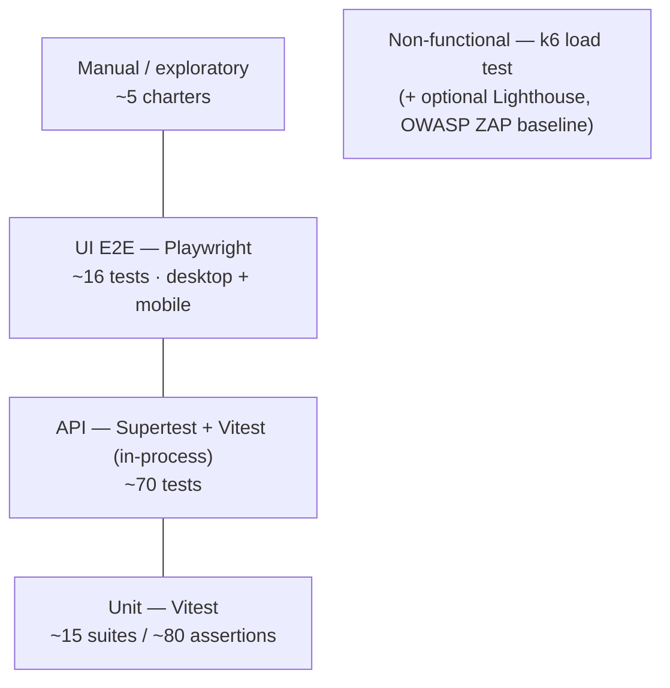

# Stage 7a — Test Strategy

Related: [Test cases](07-test-cases.md) · [Traceability matrix](07-traceability-matrix.md) · [Bug log](07-bug-log.md) · [Non-functional test](07-non-functional-test.md)

## 1. Objectives

1. Prove that every **Must** story's acceptance criteria are met, including the negative and edge cases.
2. Protect the **highest-risk business rules** with automation: cut-off timing, no overselling, one order per day, RBAC, and single-use pickup codes.
3. Show that the system holds up under the **pre-cut-off rush** (NFR1, NFR2).
4. Give fast feedback: every push runs the full automated suite in CI in under about 10 minutes.

## 2. Scope

| In scope | Out of scope |
|---|---|
| Functional testing of all Must and built Should stories | Payment (not built, W01) |
| Unit, API and UI automation | Native mobile apps |
| RBAC and basic security checks (OWASP Top-10 basics) | Full penetration test |
| Responsive layouts at 360 / 768 / 1280 px | Every device and browser combination (only the latest Chromium and WebKit) |
| One load test: the ordering rush | Soak and long-duration stress tests |
| Email delivery (manual check) | Email deliverability and spam scoring |

## 3. Risk-based prioritisation

| Risk | Likelihood | Impact | Priority | Main test approach |
|---|---|---|---|---|
| R1 Overselling under concurrent orders | Medium | High | **P1** | API parallel test + k6 + DB constraint |
| R2 Cut-off evaluated in the wrong timezone or at the wrong boundary | High | High | **P1** | Unit boundary tests with a fake clock; API tests with the test clock |
| R3 Broken access control (role escalation, IDOR) | Medium | High | **P1** | Data-driven RBAC matrix API test |
| R4 Pickup code reuse or wrong-day pickup | Medium | Medium | **P1** | API + UI scan tests |
| R5 Validation present in the UI but missing in the API | High | Medium | **P2** | API tests that bypass the UI |
| R6 Mobile layout broken | Medium | Medium | **P2** | Playwright mobile project + manual check on a real phone |
| R7 Performance falls below target at peak | Low | Medium | **P2** | k6 load test |
| R8 Email failure blocks ordering | Low | Medium | **P3** | API test with the email adapter mocked to fail |

## 4. Test levels and tools (test pyramid)



| Level | Tool | What it covers | Where | Runs |
|---|---|---|---|---|
| **Unit** | Vitest (+ coverage via v8) | Pure business logic: cut-off, slots, state machine, money, schemas, CSV escaping, password hashing, lockout (API); formatting helpers and cart logic (web) | `backend/tests/unit`, `frontend/src/**/*.test.ts` | Every push; aim for **≥ 80% line coverage on `lib/services` and `lib/validation`** |
| **API** | **Supertest + Vitest** | Every endpoint: success, validation, error codes, RBAC, concurrency. Supertest imports the Express `app` directly, so no server or port is needed | `backend/tests/api` | Every push (in-process, against the CI Postgres) |
| **UI E2E** | Playwright (projects: `chromium-desktop`, `mobile-pixel5`) | Critical user journeys, responsive checks, and a visual comparison with the Stitch screens | `frontend/tests/e2e` | Every push (Playwright `webServer` starts the API and `vite preview` with the `/api` proxy) |
| **Non-functional** | k6 | Load at the cut-off rush; overselling invariant | `backend/tests/perf` | Run manually against the staging deployment (Netlify deploy preview + staging Render API); results in `07-non-functional-test.md` |
| **Manual** | Real phone + tablet | Camera QR scan, email, exploratory testing | — | Before the demo |

### Example tests

**Unit: cut-off boundary (TC-U-02)**
```ts
// backend/tests/unit/cutoff.test.ts
import { describe, it, expect } from 'vitest';
import { isOrderingOpen } from '../../src/services/rules';

const settings = { orderCutoff: '11:00' };
const ist = (s: string) => new Date(`${s}+05:30`);

describe('isOrderingOpen', () => {
  it('is open one second before cut-off', () => {
    expect(isOrderingOpen('2026-11-17', ist('2026-11-17T10:59:59'), settings)).toBe(true);
  });
  it('is closed exactly at cut-off', () => {
    expect(isOrderingOpen('2026-11-17', ist('2026-11-17T11:00:00'), settings)).toBe(false);
  });
});
```

**API: no overselling under concurrency (TC-API-ORD-09)**
```ts
// backend/tests/api/orders.concurrency.test.ts
import request from 'supertest';
import { describe, it, expect } from 'vitest';
import { app } from '../../src/app';
import { seedDailyItem, loginAsNewEmployee, remaining } from './helpers';

it('only one of 10 parallel orders gets the last portion', async () => {
  const itemId = await seedDailyItem({ quantity: 1 });
  const agents = await Promise.all(Array.from({ length: 10 }, () => loginAsNewEmployee()));
  // each agent is request.agent(app) holding its own session cookie
  const results = await Promise.all(agents.map(agent =>
    agent.post('/api/orders')
      .set('x-test-now', '2026-11-17T10:00:00+05:30')
      .set('Idempotency-Key', crypto.randomUUID())
      .send({ date: '2026-11-17', slotStart: '13:00', items: [{ dailyMenuItemId: itemId, qty: 1 }] })));
  const statuses = results.map(r => r.status);
  expect(statuses.filter(s => s === 201)).toHaveLength(1);
  expect(statuses.filter(s => s === 409)).toHaveLength(9);
  expect(await remaining(itemId)).toBe(0);              // never negative
});
```

**UI: golden path (TC-UI-06)**: an employee orders, staff mark the order ready and hand it over by code, and the employee sees COLLECTED. This uses two browser contexts in one test.

## 5. Test data and environments

| Item | Approach |
|---|---|
| Base data | `backend/prisma/seed.ts`: 4 role users, the 6 design dishes, today's and tomorrow's daily menu |
| Per-test data | API helpers create their own users and menu entries with unique suffixes, so tests are independent and can run in parallel |
| Clock | Fake clock in unit tests; `x-test-now` header in API and UI tests (`ENABLE_TEST_CLOCK=true` only in test environments) |
| Reset | `npm run db:reset` before each CI run; Vitest `globalSetup` (API tests) and Playwright `globalSetup` (UI tests) truncate the order tables |
| Environments | Local (Docker Postgres) → CI (Postgres service) → Staging: Netlify deploy preview + staging Render API + Neon dev branch (k6 target) → Production (smoke test only, after a `/api/health` warm-up) |
| Browsers | Chromium (desktop), Pixel 5 emulation; WebKit (iPhone 13) as a nice-to-have |

## 6. Entry and exit criteria

**Entry (for a story to enter test):** the story is coded, unit tests pass, the change is deployed to a preview, and the seed data is available.

**Exit (for release / demo):**
- 100% of P1 test cases pass; ≥ 95% of all automated tests pass
- No open **Critical** or **High** bugs; Medium bugs documented with a workaround
- Every Must story is linked to at least one passing test in the traceability matrix
- NFR1 and NFR2 thresholds met (or the deviation documented)
- CI is green on `main`

## 7. Defect management

Bugs are logged in [`07-bug-log.md`](07-bug-log.md) (or GitHub Issues with the `bug` label, using the same fields).

| Severity | Definition | Example |
|---|---|---|
| **Critical** | Data loss, a security breach, or the core flow is blocked | Overselling; an employee can read other users' orders |
| **High** | A Must feature is broken with no workaround | Cannot cancel before the cut-off |
| **Medium** | A feature is broken but a workaround exists, or an edge case fails | Lower-case pickup code is rejected |
| **Low** | Cosmetic or a copy issue | Misaligned badge at 360 px |

Every fixed bug gets a **regression test**, and its ID goes in the commit message (`fix(...): ... [BUG-007]`).

## 8. Reporting

- Playwright HTML report (CI artefact) and Vitest coverage report
- Traceability matrix status column updated at the end of each test day
- Final summary in the demo: tests by level, pass rate, coverage %, bugs by severity, and the NFR result
